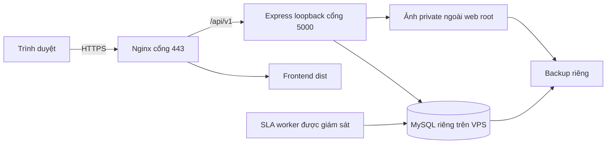

# Đưa Smart IT Helpdesk lên web — phương án ngày 26/11/2026

**Đề xuất: một VPS Linux cho Nginx + Express + SLA worker + MySQL loopback, phục vụ frontend `dist/` qua HTTPS trên cùng domain.** Cách này phù hợp hơn với chính sách database hiện tại và ảnh lưu trên đĩa. Đây là đề xuất sau nghiên cứu, chưa thuê VPS, tạo cloud resource, sửa Google Cloud, đổi production identity hoặc deploy thật.

## 1. Phương án và chi phí đã kiểm tra

Giá USD/tháng tại lần tra cứu 26/11/2026; không phải báo giá trọn gói, chưa gồm thuế, domain, backup hoặc sử dụng vượt mức.

| Phương án | Giá tham khảo từ nhà cung cấp | Đánh giá cho dự án này |
| --- | --- | --- |
| DigitalOcean Basic VPS | 2 GiB/1 vCPU/50 GiB SSD **$12**; 4 GiB/2 vCPU/80 GiB **$24**. [Giá chính thức](https://www.digitalocean.com/pricing/droplets) | Khuyến nghị cho bản thử nghiệm online: chủ động MySQL loopback, lưu ảnh và chạy worker. Tự quản lý hệ điều hành, cập nhật và recovery. 2 GiB là điểm bắt đầu để đo tải, chưa có chứng minh sức chứa production. |
| Railway | Hobby tối thiểu **$5**, được tính vào usage; tổng bill là mức tối thiểu hoặc usage thực tế cao hơn. [Pricing](https://docs.railway.com/pricing) | Thuận tiện khi triển khai qua Git, nhưng API, MySQL, volume và worker đều cần lập ngân sách. Không khẳng định toàn bộ ứng dụng chỉ tốn $5. Cần thiết kế target database production riêng phù hợp topology. |
| Render | Compute service/worker từ **$7** ở tier 512 MB; disk **$0.25/GB/tháng**. [Pricing](https://render.com/pricing) | MySQL theo hướng private service riêng có disk; không phải chuyển app sang Postgres. [Hướng dẫn MySQL](https://render.com/docs/deploy-mysql). Tổng phí phải tính cả API/DB/worker/storage; hostname private service không tương đương MySQL loopback của source hiện tại. |

Với VPS $12, backup máy ảo theo gói tỷ lệ cộng 20%/tuần hoặc 30%/ngày: tương ứng **$14.40** hoặc **$15.60** tổng base+backup mỗi tháng, tính từ mức hiện tại. Snapshot máy ảo và backup nghiệp vụ SQL/ảnh cần được đánh giá riêng. [Giá backup chính thức](https://docs.digitalocean.com/products/backups/details/pricing/).

Nếu chỉ cần demo cho buổi bảo vệ, vẫn cần API/DB/worker và lưu ảnh bền vững. Chọn provider/region sau khi biết ngân sách, vị trí người dùng và thời gian cần chạy; chưa mua hoặc đăng ký gói nào trong lượt này.

## 2. Kiến trúc đề xuất

Chỉ Nginx mở ra Internet. API và MySQL ở loopback/private; chỉ phục vụ `dist/`, không trỏ document root vào toàn bộ repository. Frontend build bằng `VITE_API_BASE_URL=/api/v1`; same-origin giúp cấu hình cookie và CSRF nhất quán. Không dùng `vite` hoặc `vite preview` làm server production. [Hướng dẫn Vite](https://vite.dev/guide/static-deploy).

## 3. Những điều kiện source hiện tại chưa có

Đây là kết quả kiểm tra mã, không phải cấu hình đã triển khai:

1. **Target database production riêng.** `targetPolicy.js`, `knexfile.js` và CLI database hiện chỉ khai báo development/test. `NODE_ENV=production` hiện vẫn chọn connection development. Không đổi `DB_NAME` sang tên prod bất kỳ rồi bỏ guard để cho chạy. Cần thêm môi trường production có schema/runtime/migration account cố định, xác minh `DATABASE()` và exact `CURRENT_USER()` cho từng purpose như hiện tại. Không nới account thành root/wildcard. VPS mới phải dùng database và credentials mới, không kết nối về máy local.
2. **Cookie HTTPS sau reverse proxy.** `app.js` hiện chưa đặt `trust proxy`; production đã bật `cookie.secure`. Với TLS kết thúc ở Nginx, phải cấu hình trusted proxy theo topology trước middleware session, để nhận biết HTTPS và rate-limit đúng client. Với một Nginx cùng VPS, có thể thiết kế trust chỉ loopback; không bật tin mọi proxy/header. [Express proxy](https://expressjs.com/en/guide/behind-proxies/), [secure session cookie](https://expressjs.com/en/resources/middleware/session/).
3. **Ràng buộc network/process và storage.** `index.js` hiện listen theo port mà chưa có tùy chọn host bind. Cần bind loopback cho topology VPS hoặc dùng firewall/network policy đã kiểm chứng; MySQL không mở public 3306. Upload và backup cần đặt ngoài thư mục release/static, có quyền ghi cho runtime user và được giữ qua deploy.
4. **Release đã review và CI của đúng source.** `main` đang thiếu các PR bảo mật/phân tuyến; các sửa F1–F5 mới còn local. Trước deploy cần publish nhóm sửa được review, chạy cả ba job CI trên đúng release và chọn commit xác định. Không tự động deploy `main` cũ.

Các mục này chưa được âm thầm áp dụng vào runtime hoặc database. Chúng thuộc bước chuẩn bị deployment tiếp theo khi đã chốt topology.

## 4. Trình tự triển khai khi đã chọn VPS/domain

1. Chốt commit release sau review/CI; backup state hiện có nếu deploy bản cập nhật. Bản online đầu tiên dùng **database mới trên VPS**, không sao chép `.env`, session hoặc năm hồ sơ TEST từ máy dev.
2. Tạo VPS, runtime user riêng, Node 24 và MySQL 8.x tương thích; chuẩn bị Nginx, DNS/domain và HTTPS. Giữ SSH được kiểm soát; public chỉ các cổng cần thiết của web.
3. Bổ sung/test production target và proxy/bind configuration ở mục 3 trước khi bật public. Provision runtime account chỉ DML trên schema đó, migration account riêng chỉ quyền schema cần thiết; kiểm tra exact identity trước DDL/seed. Owner xác nhận schema mới trước lần ghi đầu.
4. Trên release sạch, `npm ci`; build frontend bằng `VITE_API_BASE_URL=/api/v1 npm run build` trên Linux. Đặt bản `dist/` vào static root. Các biến `VITE_*` là nội dung public trong bundle, không chứa DB password, session secret hoặc OAuth secret.
5. Tạo cấu hình runtime riêng trên server, không trong public/repository. Migrate active migrations và chạy seed idempotent **chỉ với target production đã được bổ sung và kiểm tra**. CLI hiện tại chưa hỗ trợ `migrate production`, nên không coi lệnh đó là dùng được trước bước code ở mục 3.
6. Duyệt các tài khoản thật cần thiết qua cơ chế allowlist/onboarding, không bind Google `sub` giả. Khởi động Express và **một** SLA worker được systemd/PM2 hoặc process manager tương đương giám sát; bật restart/logs. Cách tách process có thể dùng hai entry point hiện có: `node server/src/index.js` và `node server/src/workers/slaWorker.js`. Nếu chọn `--with-sla-worker` thì không chạy thêm worker độc lập.
7. Trỏ Nginx đến `dist/` và reverse proxy `/api/` sang API, giữ nguyên prefix `/api/v1`. Cấu hình giới hạn body đủ cho ảnh 10 MB và multipart overhead. Không tạo static alias tới backend/private uploads hoặc backup. [Nginx proxy](https://nginx.org/en/docs/http/ngx_http_proxy_module.html#proxy_pass).
8. Đăng ký callback Google đúng domain, chạy nghiệm thu ba vai trò, upload/download ảnh, routing, cross-role/cross-team denial, restart và thông báo SLA. Sau đó mới mở rộng người dùng và đo tải/uptime trên môi trường online.

## 5. Tham số cấu hình cần chuẩn bị

Ví dụ dưới đây là **template tham số tương lai**, không phải file `.env` thật hoặc cấu hình đã được hỗ trợ đầy đủ. Phải hoàn tất mục 3 trước khi áp dụng tên DB/account production đề xuất.

| Biến | Giá trị/hướng cấu hình |
| --- | --- |
| `NODE_ENV` | `production` |
| `PORT` | `5000` sau reverse proxy |
| `CLIENT_URL` | `https://helpdesk.example.com` — thay bằng domain thật, không thêm path/trailing slash |
| `VITE_API_BASE_URL` | `/api/v1` tại thời điểm build |
| `GOOGLE_CALLBACK_URL` | `https://helpdesk.example.com/api/v1/auth/google/callback` |
| `GOOGLE_CLIENT_ID`, `GOOGLE_CLIENT_SECRET` | Cấu hình Google Cloud của owner, chỉ backend giữ secret |
| `SESSION_SECRET` | Random secret mới, ít nhất 32 ký tự; giữ qua restart/deploy |
| `DB_HOST`, `DB_PORT` | Với VPS đề xuất: `127.0.0.1`, `3306` |
| `DB_NAME`, `DB_USER` | Tên production mới được chốt trong strict policy, ví dụ đề xuất `smart_it_helpdesk_new_prod` / `sih_new_prod_app`; hiện chưa nằm trong allowlist |
| `DB_PASSWORD` | Secret riêng của runtime trên server; không dùng password dev/CI |
| Migration credentials | Chỉ trong tác vụ migration đã phê duyệt, không cấp vào process web/worker |
| `UPLOAD_DIR` | Ví dụ `/var/lib/smart-it-helpdesk/uploads`, ngoài static/release root |
| `TICKET_ROUTING_ENABLED` | Chỉ true sau khi schema và thành viên/tuyến thật đã cấu hình |
| `SMTP_*` | Để chưa cấu hình nếu tiếp tục hoãn email; chưa chạy email worker |

Callback phải khớp chính xác URI đã đăng ký trên Google, bao gồm scheme/path/slash. Owner thao tác trong Google Cloud: thêm callback public HTTPS cho web client, cấu hình consent/test users theo trạng thái app, rồi xác minh login với tài khoản approved. [Google OAuth web-server](https://developers.google.com/identity/protocols/oauth2/web-server). Không cần gửi password, OAuth secret hoặc mã đăng nhập vào chat.

## 6. Dữ liệu và vận hành sau deploy

- MySQL, ảnh private và session phải tồn tại qua restart/release. Với PaaS, cần volume cho ảnh và database; Render mặc định filesystem ephemeral, disk chỉ giữ phần dưới mount path và gắn với một instance. [Persistent disks](https://render.com/docs/disks).
- Backup gồm SQL, upload files và cấu hình/secrets được bảo vệ riêng; giữ ngoài static root, kiểm tra restore sang môi trường recovery riêng. Không chạy integration fixtures hoặc restore thử vào database production đang dùng. CI hiện chứng minh restore SQL 18 bảng của source trước, không chứng minh khôi phục ảnh/production.
- Theo dõi `/api/v1/health`, `/api/v1/ready`, lỗi API và worker logs; dùng các script monitor/report hiện có với public origin phù hợp. Lịch tạm đã chọn là thứ Hai–Sáu 08:00–17:00 giờ Việt Nam; chưa đủ kỳ quan sát để công bố uptime 99%.
- Rollback release code theo commit; không tự chạy migration down. Bảo toàn schema tương thích và backup trước thay đổi dữ liệu. Chạy lại kiểm tra role/session/routing sau restart.
- Năm hồ sơ TEST hiện có chỉ phục vụ assignment local, chưa có Google identity; không đưa chúng thành account vận hành mặc định. Nghiệm thu online cần các IT_AGENT thật được duyệt và gắn nhóm.

Đầu vào còn cần cho bước triển khai thật: ngân sách/thời gian chạy, provider/VPS, domain/DNS và owner cấu hình OAuth. Không có website public hoặc provider resource nào được tạo bởi tài liệu này.
